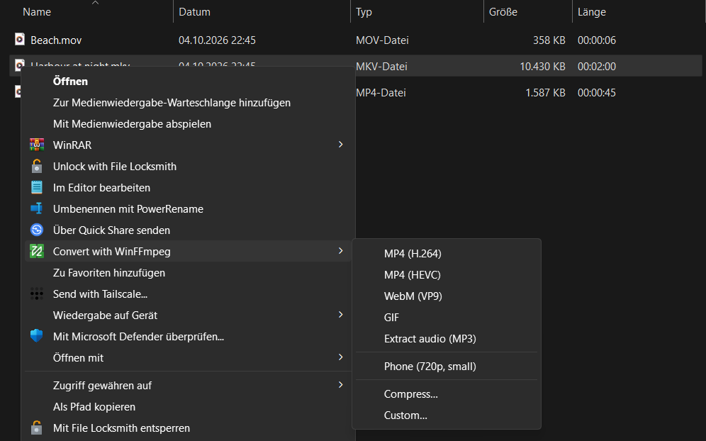
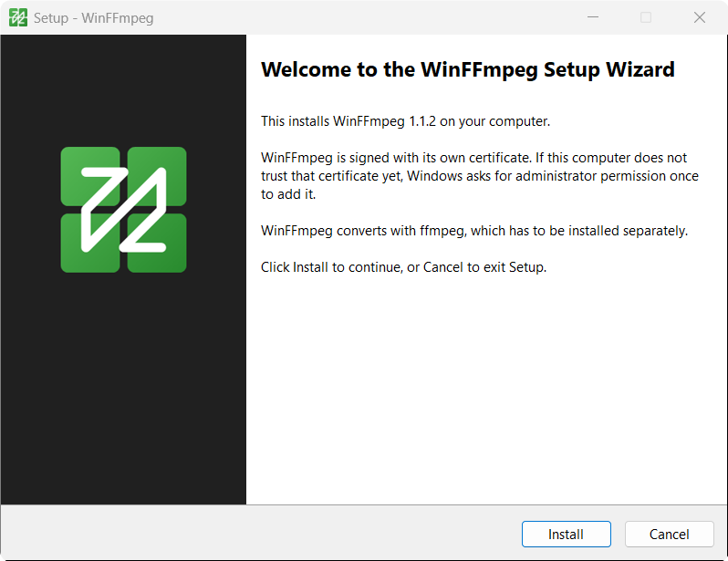

<p align="center">
  
</p>

# WinFFmpeg

WinFFmpeg adds a **Convert with WinFFmpeg** entry to the right-click menu in Windows 11 Explorer. Pick a format there and the selected videos, audio files or images are converted with [ffmpeg](https://ffmpeg.org).

<p align="center">
  
</p>

It is a native WinUI 3 app. It does not contain ffmpeg; it runs the copy installed on your machine.

## How it works

Right-click one file or a whole selection and choose a format. The conversion starts at once. A small window shows how far along each file is, how fast ffmpeg is working and how much time is left, and it closes by itself when the last file is done.

<p align="center">
  
</p>

Converted files are written next to the originals. WinFFmpeg never replaces an existing file: if `clip.mp4` is taken, the result is called `clip (1).mp4`.

**Custom…** opens the full window instead. There you choose the format, codec, quality, resolution, frame rate and a trim range. **Save as preset…** keeps the combination and puts it in the right-click menu, like "Phone (720p, small)" in the first screenshot.

<p align="center">
  
</p>

What the menu offers depends on the selection:

| Selection | Entries |
|---|---|
| Video | MP4 (H.264), MP4 (HEVC), WebM (VP9), GIF, Extract audio (MP3), Compress… |
| Audio | MP3, FLAC, WAV, Opus |
| Image | PNG, JPG, WebP |
| Any of these | your saved presets, Custom… |

[docs/usage.md](docs/usage.md) describes every entry, the options of the custom window and the settings.

## Install

You need 64-bit Windows 11 and ffmpeg. If ffmpeg is missing, `winget install Gyan.FFmpeg` installs it.

Download `WinFFmpeg-<version>-Setup.exe` from the [releases page](https://github.com/rathlinus/WinFFmpeg/releases) and run it.

<p align="center">
  
</p>

WinFFmpeg is signed with a self-signed certificate, which Windows does not know. Two prompts can come from that:

- Windows SmartScreen may stop the setup program with "Windows protected your PC". Choose **More info**, then **Run anyway**.
- Setup asks for administrator rights once, to add the certificate to the machine's Trusted People store. Later versions signed with the same certificate install without that prompt.

To uninstall, open Settings, go to Apps, then Installed apps, and remove WinFFmpeg.

The release also has `WinFFmpeg-<version>-x64.zip` for installing without a setup program: extract it and run `powershell -ExecutionPolicy Bypass -File Install.ps1` in that folder. Setup runs the same script. For an unattended install, run the setup program with `/VERYSILENT`.

## Build from source

```powershell
scripts\setup-dev.ps1        # once, from an elevated prompt
scripts\install.ps1 -Build   # build, sign and install
```

`setup-dev.ps1` installs the .NET 10 SDK, the MSVC toolset and Inno Setup, and turns on Developer Mode. [docs/development.md](docs/development.md) explains the projects, the scripts and how a click in Explorer ends up as an ffmpeg process. [docs/releasing.md](docs/releasing.md) covers publishing a version.

WinFFmpeg is an independent project and is not affiliated with FFmpeg or Microsoft.
