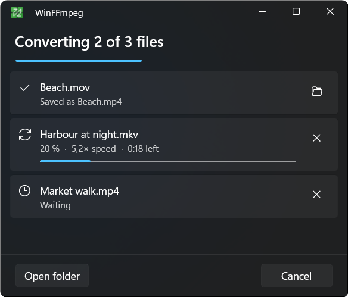
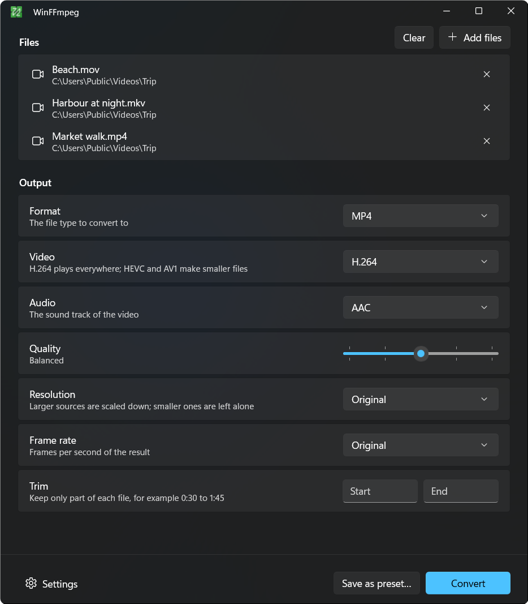
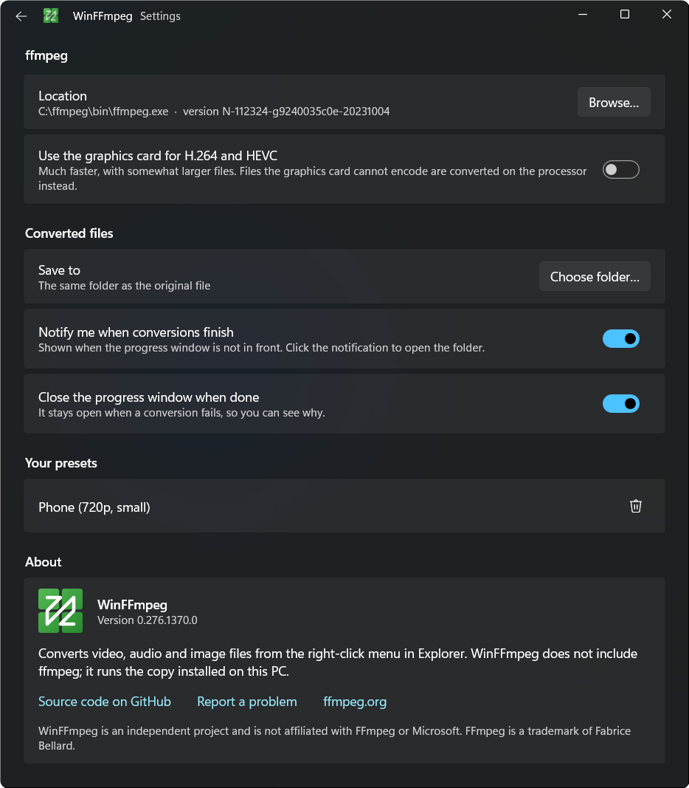

# Using WinFFmpeg

## The right-click menu

Select one or more files in Explorer, right-click and open **Convert with WinFFmpeg**. The entry is only there when the selection contains a file WinFFmpeg can read:

| Kind | Extensions |
|---|---|
| Video | `.mp4` `.m4v` `.mkv` `.mov` `.avi` `.wmv` `.webm` `.flv` `.mpg` `.mpeg` `.ts` `.mts` `.m2ts` `.3gp` `.ogv` `.vob` `.gif` |
| Audio | `.mp3` `.wav` `.flac` `.aac` `.m4a` `.ogg` `.opus` `.wma` `.aiff` `.aif` `.ac3` `.mka` `.amr` |
| Image | `.png` `.jpg` `.jpeg` `.jfif` `.bmp` `.webp` `.tif` `.tiff` `.avif` `.heic` |

Other files in the same selection are skipped.

The list of formats follows the selection. Audio and image files do not get an entry for the format they already have, so a `.wav` file is offered MP3, FLAC and Opus. A video keeps all its entries, because converting an MP4 to MP4 with another codec is a common thing to want.

A selection of videos and audio files together gets the audio formats. Videos and images share no output format, so that mix only gets **Custom…**.

On Windows 11 the entry may sit under **Show more options** instead of the short menu, depending on how the menu is configured on your machine.

## What the built-in entries do

Each entry starts converting straight away with these settings:

| Entry | Result |
|---|---|
| MP4 (H.264) | H.264 at CRF 23, AAC audio at 160 kbit/s |
| MP4 (HEVC) | HEVC at CRF 26, AAC audio at 160 kbit/s |
| WebM (VP9) | VP9 at CRF 32, Opus audio at 128 kbit/s |
| GIF | 12 frames per second, at most 480 pixels wide, with a palette built from the clip |
| Extract audio (MP3), MP3 | MP3 at VBR quality 2, about 190 kbit/s |
| FLAC | lossless |
| WAV | 16-bit PCM |
| Opus | 128 kbit/s |
| PNG | lossless |
| JPG | quality level 3 on ffmpeg's 2 to 31 scale, where lower is better |
| WebP | quality 90 |

Video conversions keep the first video stream and the first audio stream. Further audio tracks and subtitles are left out. Re-encoded video is written as 8-bit 4:2:0, which every player handles, so 10-bit and HDR sources lose that extra depth. MP4 and MOV files are written with the index at the front, so they start playing before they have finished downloading.

**Compress…** opens the custom window set to MP4 with H.264, quality "Small file" and a height limit of 1080p. The result gets ` (compressed)` added to its name.

## The progress window

<p align="center">
  
</p>

Files are converted one after another, since ffmpeg already uses every processor core for a single file. Each row shows the percentage, the speed relative to playback and the time left. The button at the end of a row cancels that file while it runs or waits, and opens its folder once it is finished.

When every file succeeded, the window closes after a moment. If a file failed, the window stays open, the row shows ffmpeg's error, and the info button opens everything ffmpeg printed along with the command line that was run.

Closing the window while files are still converting asks whether to stop. Stopping ends ffmpeg and deletes the unfinished file.

Right-clicking more files while a conversion runs adds them to the same window.

## The custom window

<p align="center">
  
</p>

**Custom…** opens this window with the selected files. You can also start WinFFmpeg from the Start menu and drop files on it, or use **Add files**.

Only the options that apply to the chosen format are shown.

| Option | Choices |
|---|---|
| Format | MP4, MKV, WebM, MOV, GIF for video. MP3, M4A, Opus, FLAC, WAV for audio. PNG, JPG, WebP for images. |
| Video | H.264, HEVC, AV1, VP9 or "Copy (no re-encode)", depending on the format |
| Audio | AAC, Opus, FLAC, "Copy (no re-encode)" or "No audio", depending on the format |
| Quality | five steps from "Smallest file" to "Best quality" |
| Resolution | Original, or a height limit from 2160p down to 360p. Smaller sources are not scaled up. |
| Frame rate | Original, 60, 30, 24, 15 or 10 frames per second |
| Trim | start and end, written as seconds (`90`) or as a clock time (`1:30`, `0:01:30.5`) |

"Copy (no re-encode)" moves the existing stream into the new container unchanged. That takes seconds and loses nothing, and it is the way to turn an MKV into an MP4 when the codec inside is already one MP4 supports.

The five quality steps map to these encoder settings:

| Step | H.264 CRF | HEVC CRF | VP9 CRF | AV1 CRF | GIF |
|---|---|---|---|---|---|
| Smallest file | 30 | 32 | 40 | 42 | 8 fps, 320 px |
| Small file | 26 | 29 | 36 | 38 | 10 fps, 400 px |
| Balanced | 23 | 26 | 32 | 34 | 12 fps, 480 px |
| High quality | 20 | 23 | 28 | 30 | 15 fps, 640 px |
| Best quality | 17 | 20 | 24 | 26 | 20 fps, 800 px |

| Step | AAC | MP3 (VBR) | Opus | JPG | WebP |
|---|---|---|---|---|---|
| Smallest file | 96 kbit/s | 7 | 64 kbit/s | 12 | 50 |
| Small file | 128 kbit/s | 5 | 96 kbit/s | 8 | 65 |
| Balanced | 160 kbit/s | 4 | 128 kbit/s | 5 | 80 |
| High quality | 192 kbit/s | 2 | 160 kbit/s | 3 | 90 |
| Best quality | 256 kbit/s | 0 | 192 kbit/s | 2 | lossless |

FLAC, WAV and PNG are lossless, so they have no quality setting.

## Presets of your own

**Save as preset…** stores the current options under a name. The preset then appears in the right-click menu for every file it can convert, between the built-in entries and **Compress…**. A trim range is not saved, because it belongs to the files at hand.

Presets are listed in Settings under "Your presets", where the bin icon deletes one.

## Settings

<p align="center">
  
</p>

### ffmpeg location

WinFFmpeg looks for `ffmpeg.exe` in the folder chosen here, then on `PATH`, then in the WinGet links folder, `C:\ffmpeg\bin` and `%ProgramFiles%\ffmpeg\bin`. When it finds none, the page offers to install ffmpeg with winget. `ffprobe.exe` is expected in the same folder. Without it conversions still run, but the progress bar cannot show a percentage.

### Use the graphics card for H.264 and HEVC

This is off by default. When it is on, WinFFmpeg encodes with NVENC, Quick Sync or AMF, whichever works on your hardware. It finds out by encoding a few frames with each. GPU encoders are usually faster than the processor and produce somewhat larger files at the same quality step. A file the GPU encoder rejects is converted again on the processor.

### Save to

Converted files go next to the original unless you choose one folder for all of them.

### Notify me when conversions finish

WinFFmpeg shows a Windows notification when the queue is done and the progress window is not in front. Clicking it opens the folder.

### Close the progress window when done

Turn this off to keep the window open after a successful run.

### About

The card at the bottom of the page shows the installed version and links to the source code and the issue tracker. Include the version when you report a problem.

## From a terminal

Installing WinFFmpeg also adds the `winffmpeg` command.

```powershell
winffmpeg clip.mkv                         # open the custom window with this file
winffmpeg --run video-mp4-h264 a.mkv b.mov # run a preset on these files
```

The ids of the built-in entries are `video-mp4-h264`, `video-mp4-hevc`, `video-webm`, `video-gif`, `audio-mp3`, `audio-flac`, `audio-wav`, `audio-opus`, `image-png`, `image-jpg` and `image-webp`. `--run compress` and `--run custom` open the custom window.

## If something does not work

### "ffmpeg was not found"

Open Settings and choose the folder that contains `ffmpeg.exe`, or install ffmpeg with `winget install Gyan.FFmpeg`.

### A conversion fails

The info button on the failed row shows ffmpeg's output. Encoders such as `libx265` or `libsvtav1` are missing from some ffmpeg builds; the "full" builds from [gyan.dev](https://www.gyan.dev/ffmpeg/builds/) include them.

### The menu entry is missing after installing

Look under **Show more options** first. If it is not there either, restart Explorer: sign out and back in, or restart "Windows Explorer" in Task Manager.

### The first start is slow

The first launch after an install can take several seconds. Later starts take about a second.
